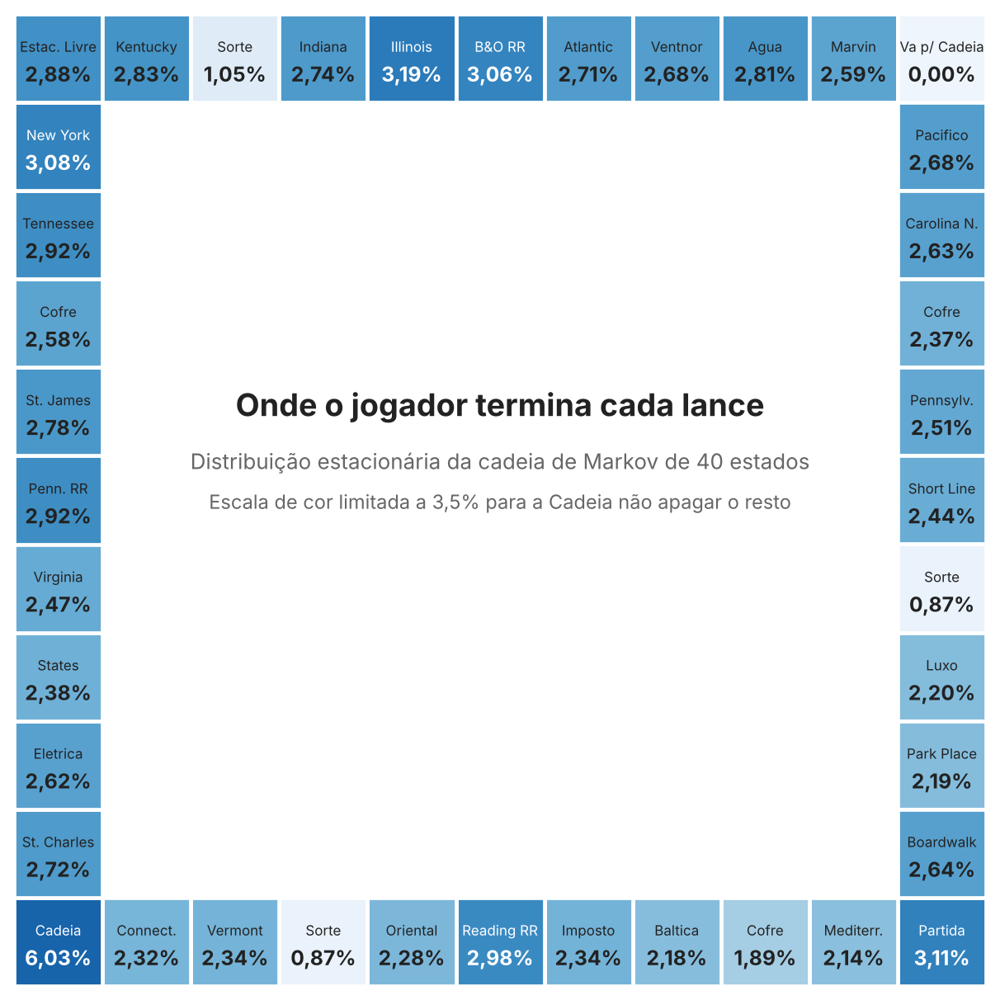
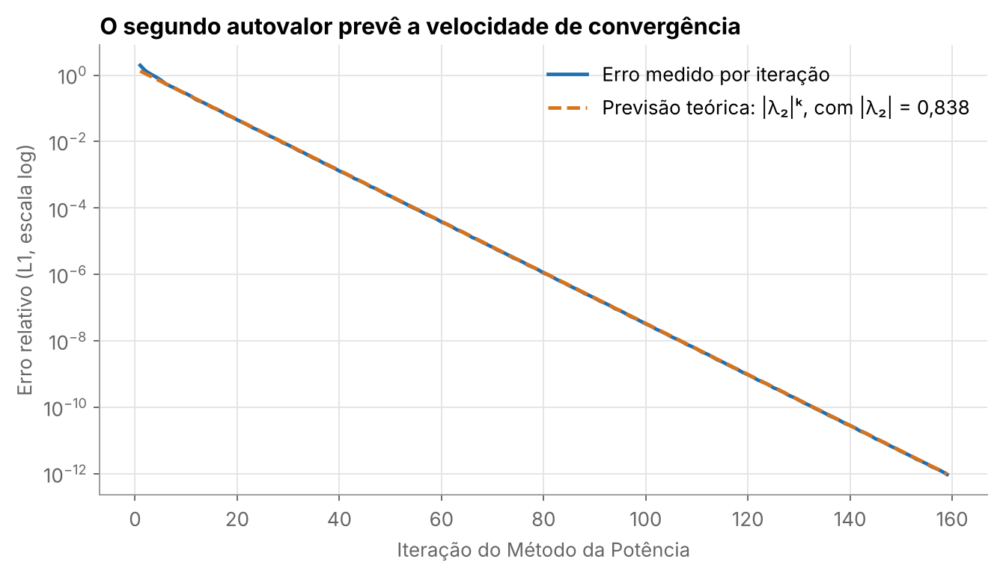
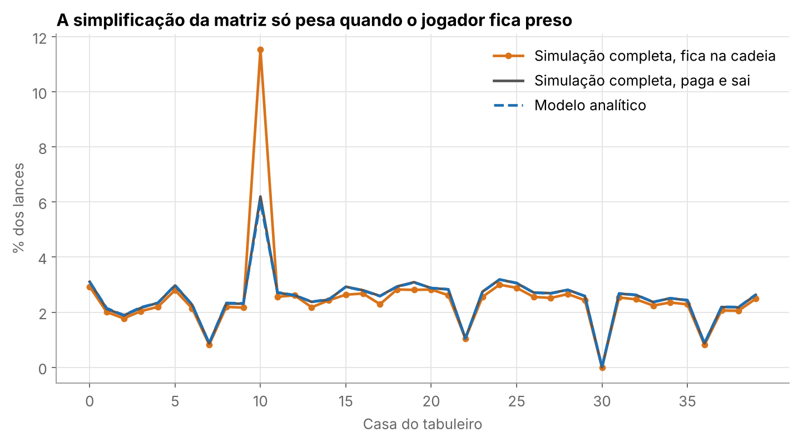
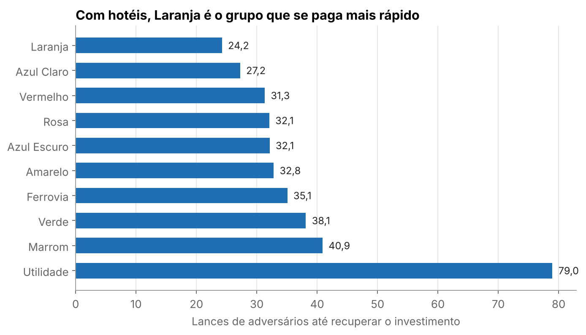

# A matemática por trás do Monopoly

**Em que casa você mais cai, e qual grupo realmente compensa comprar?** Modelei o tabuleiro como uma cadeia de Markov de 40 estados, encontrei a distribuição de longo prazo com o Método da Potência e testei o modelo contra 12 milhões de lances simulados.



## Principais resultados

| Pergunta | Resposta |
|---|---|
| Casa mais visitada | Cadeia, com **6,03%** dos lances, quase o dobro da segunda colocada (Avenida Illinois, 3,19%) |
| Grupo que se paga mais rápido com hotéis | **Laranja**: 24,2 lances de adversários, contra 40,9 do Marrom |
| Quando o jogo "esquece" a posição inicial | Cerca de **26 lances** para a influência cair abaixo de 1% |
| Precisão do modelo se o jogador sai logo da cadeia | Distância L1 de **0,005** para a simulação das regras completas |
| Principal limitação do modelo | Se o jogador fica preso, a Cadeia sobe para **11,53%** e a matriz não captura isso |

## De onde veio a ideia

O projeto nasceu de um exercício de COCADA sobre um tabuleiro de 8 casas. Fiquei curiosa: e se aplicasse a mesma ideia a um jogo de verdade? O projeto poderia ter ficado bem mais curto, mas acabei me divertindo brincando com probabilidades e matrizes. A jornada completa está no [notebook](monopoly.ipynb).

## Como funciona

1. **Modelagem.** Cada regra é uma transformação sobre a matriz de transição: dados, "Vá para a Cadeia", cartas de Sorte, cartas de Cofre e duplos repetidos. A ordem importa: "Volte 3 casas" na casa 36 cai em um Cofre, então Sorte é aplicada antes.
2. **Solução.** O Método da Potência, $v^{(k+1)} = A v^{(k)}$, converge em 159 iterações para o autovetor de $\lambda = 1$. É o mesmo princípio do PageRank: o estado estacionário de um passeio aleatório.
3. **Validação.** Uma simulação de Monte Carlo testa a implementação e o efeito das simplificações.
4. **Decisão.** Frequência de visita, aluguel e custo se tornam tempo de retorno por grupo.

## Decisões técnicas

**Por que a Potência Inversa usa aritmética complexa?** O segundo maior autovalor forma um par conjugado, $0{,}371 \pm 0{,}751i$, com módulo $0{,}838$. Um deslocamento real ficaria equidistante dos dois e não convergiria para nenhum, então usei um deslocamento complexo.

**O autovalor prevê o comportamento do algoritmo.** O erro medido em cada iteração acompanha $|\lambda_2|^k$:



**Dois testes, duas perguntas.** Uma simulação com as mesmas hipóteses da matriz verifica se o código está certo (L1 = 0,003). Outra, com as regras completas, verifica se as hipóteses são boas:



**Corrigir a própria métrica.** Minha primeira métrica, probabilidade por preço, colocava o grupo Marrom no topo, contrariando o conselho clássico. O problema é que ela ignora quanto cada visita rende. Com o aluguel, o resultado muda:



Sem construções, a ordem é outra: ferrovias e companhias lideram, porque já rendem o aluguel máximo. Mesmo usando as frequências de quem fica preso, Laranja continua em primeiro.

**Da foto ao mapa de calor.** Na primeira versão, eu mostrava a matriz 40x40 em uma foto. Depois de um comentário do monitor na apresentação, passei a usar mapas de calor em todas as matrizes.

## Limitações

- A matriz de 40 estados não guarda há quanto tempo o jogador está preso nem quantos duplos tirou. Um espaço de estados ampliado resolveria isso.
- Os três duplos entram como um incremento médio, não como uma regra exata.
- O tempo de retorno ignora liquidez, leilões, falências e o comportamento dos outros jogadores.
- A estimativa inicial de $\lambda_2$ vem de `numpy.linalg.eigvals`. A Potência Inversa refina e confirma esse valor, mas não o descobre sozinha.
- Cartas de saída grátis da cadeia são tratadas como cartas sem movimento.

## Estrutura

```
monopoly/
  tabuleiro.py    casas, preços, aluguéis e cartas
  transicao.py    construção da matriz, uma regra por função
  metodos.py      Potência e Potência Inversa
  simulacao.py    Monte Carlo, simplificado e completo
  economia.py     tempo de retorno por grupo
tests/            13 testes, incluindo o confronto entre matriz e simulação
scripts/          regenera figuras e results/resultados.json
monopoly.ipynb    a narrativa completa
```

## Como reproduzir

```bash
pip install -r requirements.txt
pytest
python scripts/gerar_resultados.py
```

## Stack

Python, NumPy, Matplotlib, pytest.

## Referências

- Hannah Fry e Thomas Oléron Evans, *The Indisputable Existence of Santa Claus*.
- [The Mathematics of Winning Monopoly](https://www.youtube.com/watch?v=ubQXz5RBBtU), Stand-up Maths.
- [Monopoly: The Mathematical Secret Behind Winning](https://www.youtube.com/watch?v=8FP8Owdt2WY).
- [Tabela de aluguéis da edição americana](https://www.falstad.com/monopoly.html).

## Sobre o desenvolvimento

O modelo, os métodos numéricos e a análise original foram desenvolvidos por mim como trabalho da disciplina de COCADA, na UFRJ. A reorganização em pacote, os testes, a simulação de Monte Carlo e a análise de retorno foram feitas depois, com apoio de IA (Claude), como extensão para este portfólio.

---

Maria Carolina Boudreaux Ramirez Deleito · Ciência da Computação, UFRJ
